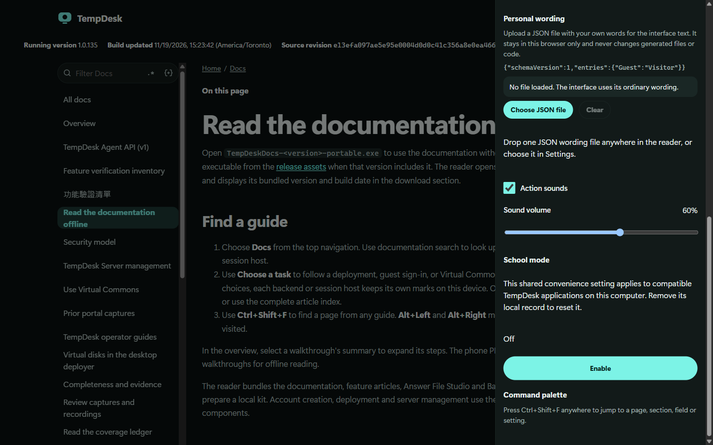
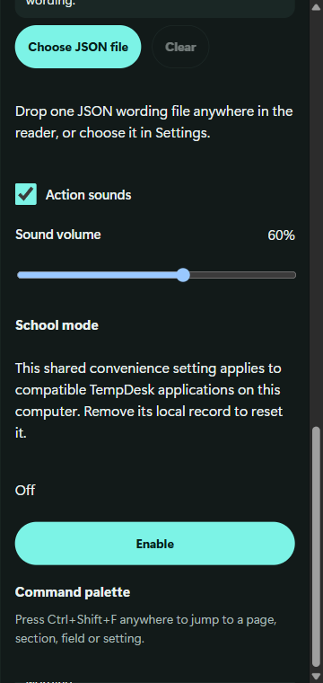

# Read the documentation offline

Open `TempDeskDocs-<version>-portable.exe` to use the documentation without a web connection. Get the executable from the [release assets](https://github.com/Ding-Ding-Projects/tempdesk-/releases) when that version includes it. The reader opens the TempDesk home page and displays its bundled version and build date in the download section.

## Find a guide

1. Choose **Docs** from the top navigation. Use documentation search to look up a task such as setting up a session host.
2. Use **Choose a task** to follow a deployment, guest sign-in, or Virtual Commons checklist. For a task with choices, each backend or session host keeps its own marks on this device. Open a guide from the checklist or use the complete article index.
3. Use **Ctrl+Shift+F** to find a page from any guide. **Alt+Left** and **Alt+Right** move through the pages you visited.

In the overview, select a walkthrough's summary to expand its steps. The phone PDF includes the expanded walkthroughs for offline reading.

The reader bundles the documentation, feature articles, Answer File Studio and Base64 toolkit. The Studio can prepare a local kit. Account creation, deployment and server management use their corresponding TempDesk components.

## Read the phone PDF

Open `TempDeskDocs-<version>-phone.pdf` from the [release assets](https://github.com/Ding-Ding-Projects/tempdesk-/releases). The PDF has 105 mm by 187 mm pages and contains the complete guides, feature articles and operator wiki from the release's documentation source. The table of contents opens each chapter directly. Use **Contents** at the start of a chapter to return to the index. Links between included articles stay inside the PDF. Links to public sources and browser tools open those sites when a connection is available.

The [published v1.0.129 PDF receipt](evidence/phone-edition-v129.json) lists every article and opening page. It records the measured page sizes, linked contents, return links, cross-references, and inspected pages from that release.

## Local settings and reference links

The reader keeps language, theme and other browsing preferences in its own local profile. Settings and files you open in the bundled tools are processed locally. A selected HTTPS reference or release link opens in your browser, where that destination's network requirements apply.

### Apply personal wording

Drop one wording JSON file on the reader or choose **Settings**, then **Choose JSON file**. The Base64 toolkit's own file area accepts files for that tool. The reader applies a valid wording file after saving it locally. The confirmation fades on its own. A rejected file keeps the current wording and displays a dismissible notice. Choose **Clear** in Settings to restore the original wording.

In bilingual mode, the standard confirmation and rejection show English and Cantonese on separate lines. A display name you supply appears as written. If you choose an invalid file in Settings, the rejection remains available to dismiss after you close Settings.

Use **Action sounds** and **Sound volume** in Settings to control the two import cues. With sound off, the reader still shows the result. The reader keeps these preferences in its local profile. System or reader reduced-motion settings make the success confirmation static.

### Use the shared focus setting

Open the shared focus control in **Settings**. Choose **Enable**, enter a display name, and confirm a PIN of 4 to 12 digits. The reader and Deployer share that local setting on the current computer. The reader uses English while it is active. Settings search and the command palette inherit the mode for its language, personal wording, and action sound controls. Theme, Motion, and Text size stay available.

Use **Unlock** with the current PIN to restore the saved reader preferences. **Rename** changes the displayed name and keeps the mode active. A rejected Rename preserves the proposed name for another attempt. If the shared setting is unavailable, choose **Retry**. The focus setting is a local convenience control. Removing its local record resets it.

The article, wiki, and search index filtering work is tracked in the [roadmap](../ROADMAP.md#documentation-and-delivery).

Release builds bundle the tracked source from the release revision. The generated article source links open that revision.

The source archive preserves the committed bytes of the evidence JSON. Its receipt hashes can be compared across the portable reader and hosted documentation.

The local reader displayed this control at both widths.

The run used an isolated profile and left the mode off. PIN changes and cross-application transitions remain pending. [Visual evidence inventory](evidence/offline-school-e13efa0/inventory.json)

## Build and verify

Run `build.bat /docs` from the root of a Git checkout. The executable and phone PDF appear under `deployer/bin/docs/`. The default `build.bat` and `build-installer.bat` produce both files from the same site composition.

To verify a build, launch the single executable from an otherwise empty directory and open the documentation index, the Virtual Commons guide, and the operator wiki. Search for a phrase from the guide and check that the matches and navigation work offline. The date and version on the home page identify the bundled copy.

Open the PDF offline and follow a guide, a feature article and the operator wiki from **Contents**. Check a link to a section in another chapter and a **Contents** link back to the index. The version and source revision on the first page identify the release copy.

Next, read [Use Virtual Commons](VIRTUAL-COMMONS.md) or return to the [TempDesk overview](../README.md).
