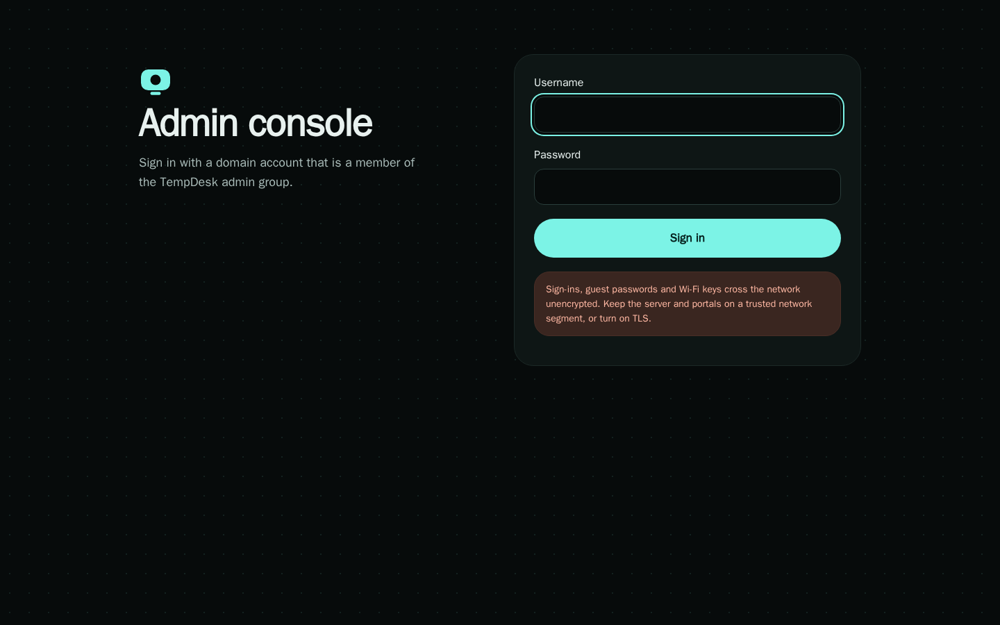
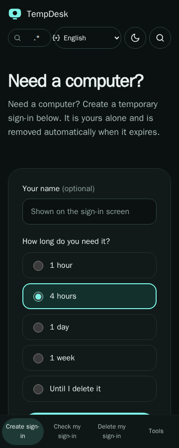
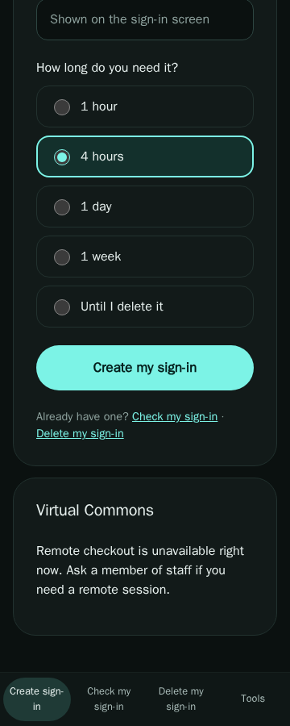

# Prior portal captures

The management sign-in (1440 × 900) and guest kiosk (360 × 900) were captured on November 18, 2026 (Eastern Standard Time) in isolated headless Chromium. Both used dark theme, reduced motion, and device scale 1. The running containers used source revision `ae447bff5de5f4bd753ea0c1cc758a83a250978c` and image ID `sha256:d917d89b9563ef499c26008781a32661a9409730add6a8187de2c272c3f5b5da`. Both entry points answered from a separate container network namespace. The images show the unauthenticated entry points, with empty credential fields. Remote Desktop destinations were unavailable during this run.

| Management sign-in | Guest kiosk |
| --- | --- |
|  |  |

At 04:40:47 EST on November 18, 2026, isolated headless Chromium captured the running portal at 360 × 900 in dark theme with reduced motion and device scale 1. The kiosk showed the Virtual Commons unavailable state alongside ordinary guest sign-in. Source revision `e097ba72ae64966003612fd9faa5309d38411109` built image `sha256:1480193678dbb4787ea4c830a0a1ea87ff4f605bf370e1f9fcbd65b63a6220cd`. PNG SHA-256 `a233cbed419c73e9326005e6171eb11c92529224fc0f8fd8e68a05a7717473ce`.

## Earlier guest sign-in walkthrough

The [original sign-in verification inventory](guest-sign-in-inventory.json) records source revision `3a18b69c04ceace56d70d694b5d8181de63ec9b3`, capture times and hashes. Its original images show [duration selection](guest-sign-in-3a18b69/01-choose-duration.png), [duration selection at 360 px](guest-sign-in-3a18b69/01-choose-duration-narrow.png), [sign-in confirmation](guest-sign-in-3a18b69/02-sign-in-ready.png), [expiry countdown](guest-sign-in-3a18b69/03-expiry-countdown.png), [active status](guest-sign-in-3a18b69/04-active-sign-in.png) and [deletion](guest-sign-in-3a18b69/05-test-sign-in-deleted.png).
